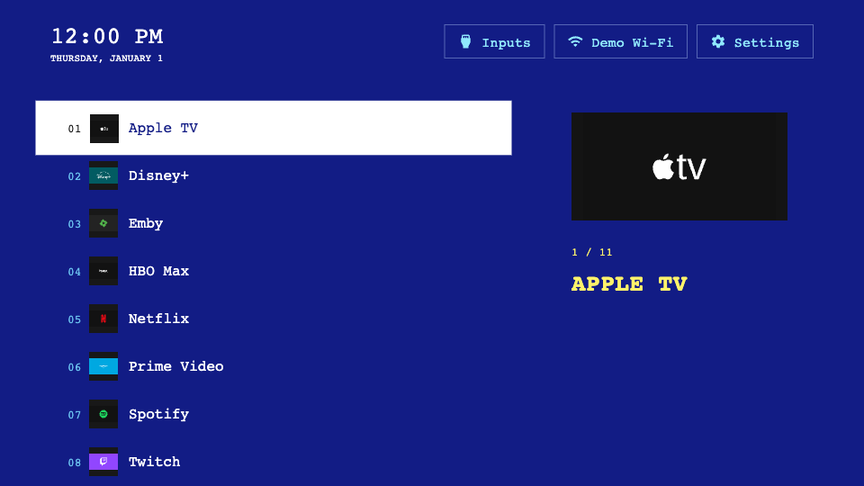
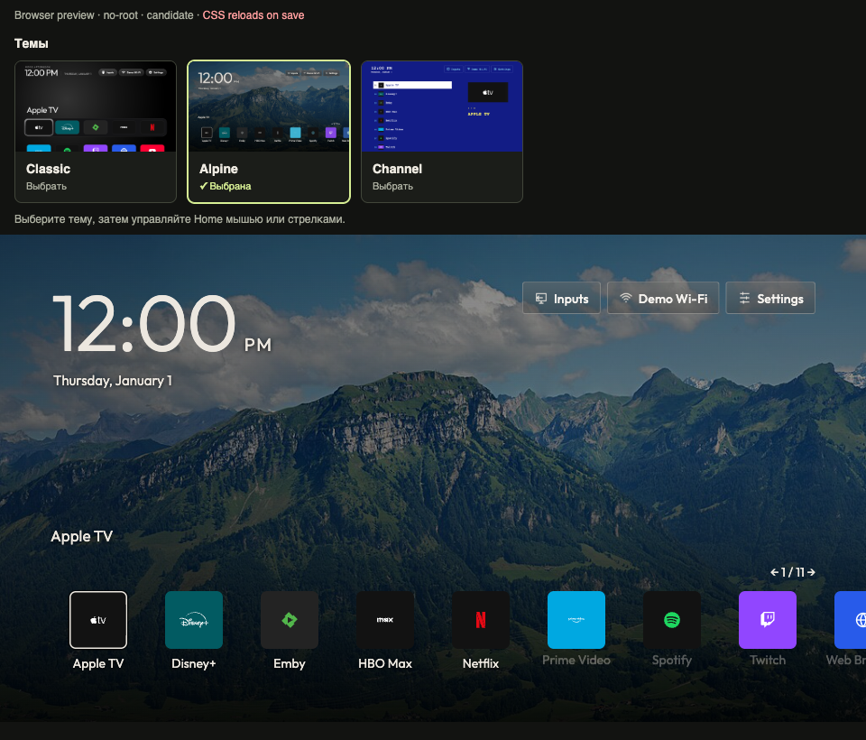

# Classic, Channel, Alpine and Sharingan

The live showcase includes four choices:

| Theme | Composition | Default columns | Source |
| --- | --- | --- | --- |
| [Alpine](glasshouse/theme.css) | Scenic wallpaper, large clock and one looping bottom ribbon | 8 | Editable example in `glasshouse/` |
| [Itachi · Sharingan](itachi/README.md) | Dark portrait, crimson eyes and CSS-only white native icons | 5 | Editable source in `itachi/` |
| Classic | Original Home shelf and grid | 5 | Built into the renderer; uses trusted reset, no theme CSS copy |
| [Channel](terminal/theme.css) | Blue teletext-style numbered list with a selected title | 1 | Editable example in `terminal/` |

Classic and Channel allow the TV user to override their column defaults.
Alpine fixes its author composition at eight columns and hides that setting;
the saved user choice resumes when switching back to Classic or Channel. Settings use the
standard trusted appearance. The `terminal` directory and Channel theme ID stay
stable. Alpine is an independent interpretation of the Glasshouse Home composition.
Its `scenic-grid` layout loops horizontally with Left/Right; Up enters shortcuts and Down
returns to the same app.
The selected app index appears above the ribbon. Wallpaper attribution and license
are in `glasshouse/CREDITS.txt` and `glasshouse/LICENSE.txt`.

## Open the live showcase

Install Node.js 22+ and obtain the explicit candidate runtime as described in
[runtime preparation](../docs/runtime.md). No official runtime download is
published yet. From the toolkit root:

```sh
npm ci --ignore-scripts
npm run theme -- showcase examples --runtime .runtime/candidate --port 8877
```

Open **http://127.0.0.1:8877/**. Classic is selected initially. Click Alpine, Channel, Itachi · Sharingan or
Classic above the actual Home screen, then use the mouse or arrows/Enter inside
it. Switching does not reload Home; app order and saved column preferences are retained.
App launches and TV services are simulated. Keep the terminal open; Ctrl+C stops
the server. Save the selected theme's CSS to see validated changes live.

To preview just Channel:

```sh
npm run theme -- preview examples/terminal --runtime .runtime/candidate --edition no-root
```

Open the printed loopback URL. The complete 1920×1080 TV canvas scales to the
PC window. Edit `examples/terminal/theme.css` and save. Before publishing a copy,
change its repository identity, title, author and version. Each theme needs its
own license, credits and manifest.

## Channel behavior

Channel uses a readable numbered list and a large selected-app icon/title with
a position counter in its default single-column layout. Explicit choices of
2–4 columns use full-width rows; 5–8 use compact labelled icon cells. The app
library shares its square blue/cyan styling. Held OK, reorder, Add app and
keyboard Close keep their labels/focus readable. Missing icon previews remain
hidden; app labels and fallback initials still identify the app.

See the [browser QA record](../docs/channel-review.md) for tested scenarios.

## Channel screenshots



[Inputs](terminal/previews/inputs.png) · [Settings](terminal/previews/settings.png) · [Manifest](terminal/theme.json)

The [static gallery](index.html) opens without Node/runtime and compares saved
Channel Home, Inputs and Settings images. Classic's live view comes from the
renderer's own built-in styles rather than a saved imitation.

These No-root browser captures use synthetic data and a fixed clock. The
`terminal/previews/provenance.json` file records candidate-runtime provenance.
The runtime must support trusted layout presets. Browser screenshots do not
establish physical-TV acceptance. Candidate APIs may still change.

To regenerate the captures into a new empty output directory:

```sh
npm run theme -- screenshots examples/terminal --runtime .runtime/candidate --out .runtime/channel-captures
```

A local Chrome can be selected with `--browser-executable /absolute/path/to/chrome`.
Replace previews and provenance together after review. Demo icon sources and
licenses are in [DEMO-ICON-CREDITS.txt](DEMO-ICON-CREDITS.txt),
[DEMO-ICON-LICENSE.txt](DEMO-ICON-LICENSE.txt), and Channel's `CREDITS.txt`.

## Fixed author layouts

Set `layout.allowColumnOverride` to `false` in `theme.json` to hide the Columns
setting and keep the author's column count. Omit it, or set `true`, to let users
choose. Alpine demonstrates the fixed option; Channel remains adjustable.
The saved user value is preserved across theme switches. This candidate field
requires a freshly exported runtime with column-policy support.

The flag controls user reflow, not arbitrary CSS coordinates. Choose a supported
trusted preset for placement. The renderer continues to own remote navigation,
focus and hit areas; external CSS controls the exposed visual parts.

## Alpine interaction polish

The selected app's full name stays above the ribbon without a slide/fade. Wider
28px captions make normal names easier to read; Add app can use two lines.
The single 3px focus border replaces nested frames. Upper shortcuts are larger;
Latin AM/PM is a smaller label, while locale time preferences remain unchanged.

Use a mouse wheel or touchpad over the ribbon to step in either direction.
Trusted dialogs block this input. A clipped next-card preview is a continuation
hint and becomes clickable after it is fully revealed; hovering that hint cannot
auto-pan the ribbon. Reduced motion remains supported. See the
[UI/UX review](../docs/glasshouse-ux-review.md) for browser coverage and limits.

## Image-card picker

The live showcase now uses 16:9 Home preview cards with a theme name and a
visible selected state. Click the image/card or use Tab and Enter/Space. On a
narrow window the card strip scrolls horizontally without widening the page.

Classic uses a real built-in renderer capture supplied by the candidate runtime.
Other cards use their manifest's `previewAssetId`, served only after source
validation. A missing image shows a fallback without breaking Home selection.
The card stylesheet is shared with the main project's community showcase; the
latter still publishes only reviewed registry entries. A built-in Classic sample
is identified separately. New card UI requires the refreshed candidate runtime.



## Button icon examples

Alpine uses original outline artwork; Channel uses original pixel artwork for Inputs, network and Settings. See [the icon recipe](../docs/authoring.md#replace-header-button-icons). Alpine retains its existing `glasshouse` directory and stable ID so installed theme identity is preserved.

## Sharingan authoring

[Itachi · Sharingan](itachi/README.md) lives in this toolkit and uses the same
validate/preview/build commands as other themes. Its public runtime capability
`modern-icon-css-v1` enables bounded icon filters and paint scaling while
retaining native app images. Use the exact paired runtime; older exports reject
its CSS. The toolkit theme ID differs from the historical main-project ID; old
packages and installed versions are not silently migrated. Its image license is
personal/non-commercial fan use; preserve its separate notices.
