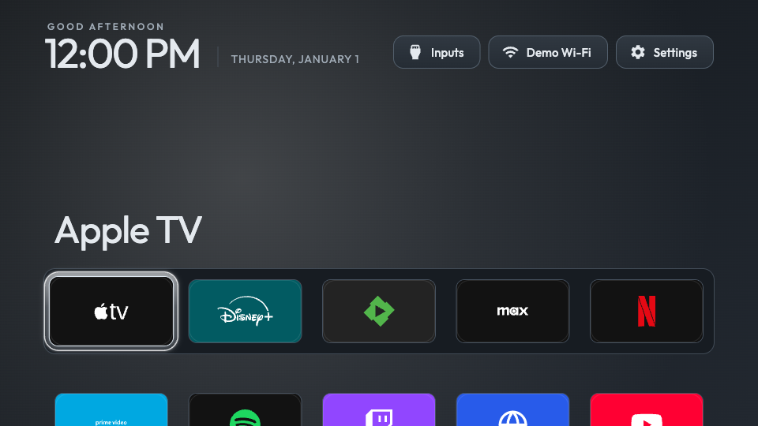
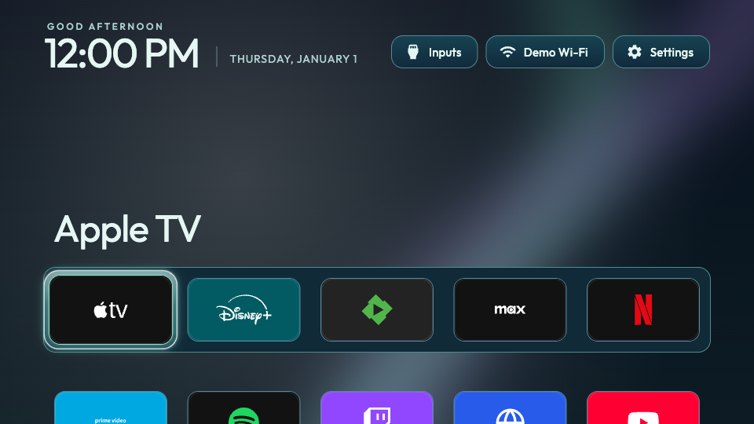
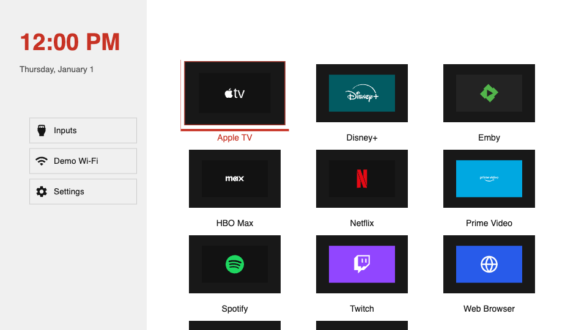

# Example themes

Four complete starting points using the same public theme API. Each includes
editable CSS, a manifest, license, credits and a real browser-rendered preview.
[Open the visual gallery](index.html) locally, or compare the Home images below.

| Theme | Composition | Default columns | Wallpaper |
| --- | --- | --- | --- |
| [Pure](minimal/theme.css) | Small square icons on black, no shelf or hero | 6 | None |
| [Postcard](aurora/theme.css) | Large original illustration with a low app shelf | 5 | Original cut-paper mountains |
| [Index](gallery/theme.css) | Clock and vertical menu in a fixed left sidebar; grid on the right | 3 | None |
| [Channel](terminal/theme.css) | Numbered list and selected title, inspired by teletext | 1 | None |

The author sets the default column count in `theme.json`. The TV user's explicit
setting takes precedence. App logos retain their own branding. Settings use the
standard trusted appearance with the theme suspended.

## Pure



[Inputs](minimal/previews/inputs.png) · [Settings](minimal/previews/settings.png) · [Manifest](minimal/theme.json)

## Postcard



[Inputs](aurora/previews/inputs.png) · [Settings](aurora/previews/settings.png) · [Manifest](aurora/theme.json)

## Index



[Inputs](gallery/previews/inputs.png) · [Settings](gallery/previews/settings.png) · [Manifest](gallery/theme.json)

## Channel


[Inputs](terminal/previews/inputs.png) · [Settings](terminal/previews/settings.png) · [Manifest](terminal/theme.json)

## Switch themes on one live Home screen

```sh
npm run theme -- showcase examples --runtime .runtime/candidate --port 8877
```

Open **http://127.0.0.1:8877/**. The buttons above the real Home renderer switch
local themes without a reload. Mouse and arrow/Enter navigation work inside the
screen; app launches and TV services are simulated. Explicit user columns and
app order are retained. Keep the terminal running; Ctrl+C stops it. Every local
subdirectory with `theme.json` becomes a choice; editing the selected source
still triggers validated live reload. No scripts from a theme are executed.

## Open an interactive example on your PC

From the toolkit root, install Node.js 22+ and dependencies, then obtain the
explicit candidate runtime as described in [runtime preparation](../docs/runtime.md).
No official runtime download is published yet.

```sh
npm ci --ignore-scripts
npm run theme -- preview examples/aurora --runtime .runtime/candidate --edition no-root
```

Open the printed loopback URL, usually **http://127.0.0.1:8766/**. Keep the terminal
open. The full 1920×1080 TV canvas scales to your browser window. Use arrows,
Enter, Back or the mouse; edit `examples/aurora/theme.css` and save to see changes.
Replace `aurora` with `minimal`, `gallery` or `terminal`. Stop with **Ctrl+C**.
For a theme you plan to publish, copy a directory into your own collection and
change its repository identity, title, author and version before publishing.

The static `index.html` can also be opened directly, without Node or runtime;
it compares saved screenshots, with Home / Inputs / Settings switches.

## Evidence and artwork

These are No-root browser captures from the actual candidate Home renderer,
with synthetic demo data and a fixed clock. These examples require the updated
candidate runtime with trusted layout presets; the earlier dock-grid-only
candidate cannot load Pure, Index or Channel. Directory slugs and theme IDs
remain stable even though the display names changed. Each `previews/provenance.json`
records the runtime snapshot and browser. Browser screenshots do not establish
physical-TV acceptance. Candidate APIs and visuals may still change.

Regenerate the original Postcard wallpaper with `node scripts/generate-example-art.cjs`.
Capture each theme using the same candidate runtime:

```sh
npm run theme -- screenshots examples/aurora --runtime .runtime/candidate --out .runtime/aurora-captures
```

Use an empty output directory. A locally installed Chrome can be selected with
`--browser-executable /absolute/path/to/chrome`. Replace the committed previews
and their provenance together after reviewing the results. Demo icon sources and
licenses are in [DEMO-ICON-CREDITS.txt](DEMO-ICON-CREDITS.txt),
[DEMO-ICON-LICENSE.txt](DEMO-ICON-LICENSE.txt), and every theme's `CREDITS.txt`.

Visual research: [CleanYourTV's theme gallery](https://lasharor.github.io/cleanyourtv-WebOS/themes/)
and [Luma](https://github.com/ecklf/lg-luma). The CSS and wallpapers here are
original; no theme code or wallpaper was copied from those projects.

The live showcase starts with **Classic**, the renderer's built-in appearance.
Classic calls the trusted reset path rather than loading a CSS imitation.
It restores the original layout and default of 5 columns, while an explicit
user column choice still takes precedence. Other themes remain selectable.
