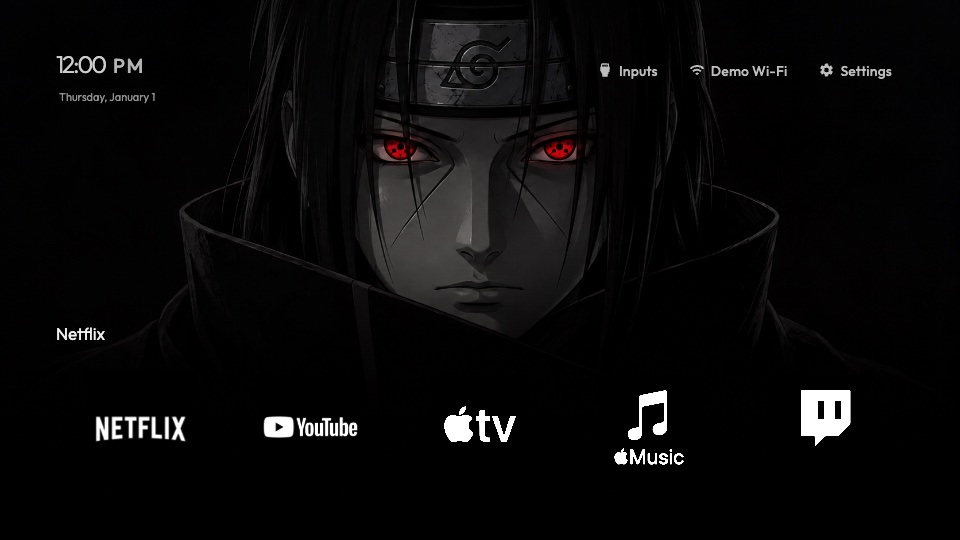

# Itachi · Sharingan

Editable Sharingan 1.0.1 sources live here in the author toolkit. The theme uses a
dark generated Itachi wallpaper, crimson eyes, five visible app columns and
CSS-only white icon effects. Native application images are never replaced.

## Edit, preview and validate

Use the complete runtime paired by `runtime.lock.json`; the previous toolkit
runtime rejects this theme's clock font size and modern icon CSS. The candidate
bundle includes that runtime. Source checkouts follow [runtime preparation](../../docs/runtime.md).
From the toolkit root:

```sh
npm ci --ignore-scripts
npm run theme -- showcase examples --runtime .runtime/candidate --port 8877
npm run theme -- validate examples/itachi --runtime .runtime/candidate
npm run theme -- preview examples/itachi --runtime .runtime/candidate --edition root
```

Select **Itachi · Sharingan** in the showcase. Edit `theme.css` and save to refresh
the live renderer. Invalid edits keep the last valid design and report the error.
Edit `theme.json` for assets, layout and version. The same public contract can be
used for your own themes; copy to a new folder and change its repository identity,
title, author and notices before publishing a distinct theme.

The ordinary browser preview is not an embedded text editor. Use **Send to TV**
for a local snapshot, or **TV link** for a descriptor already published at a fixed
GitHub commit. Opening the preview or building locally does not publish a link.

## Build a distribution

Commit all files in the theme folder before a distribution build. Run this from
the toolkit root, using a new/empty output directory:

```sh
npm run theme -- build examples/itachi \
  --runtime .runtime/candidate \
  --source-repository https://github.com/razdva122/clean-your-tv-lg-theme \
  --source-commit "$(git rev-parse HEAD)" \
  --out dist/itachi/1.0.1
```

The output contains `cytv-theme.json`, typed rules, hashed images/notices and a
validation report. It is a data-only package. Build checks retain committed-source,
identity, digest and resource validation; there is no raw CSS or executable-theme
bypass. Use the [publishing guide](../../docs/publish.md) to publish a new immutable
distribution before generating a public installation link.

## Identity and legacy installations

This repository's editable theme ID is
`github:razdva122/clean-your-tv-lg-theme:itachi`. The earlier
`github:razdva122/clean-your-tv-lg-webos:itachi` and its published 1.0.0/1.0.1
packages remain with the main project. Existing URLs and installed identities are
unchanged. This toolkit identity installs separately; it does not silently migrate
or update an existing legacy installation. The main project retains its old source
and fixtures for reproducibility; edit this folder for the toolkit edition.

## Effects and limits

The compiler adds `modern-icon-css-v1` automatically. The pinned candidate requires Home 1.6.0 or later with that
capability and CSS filters/screen blending; older browsers reject the theme before
changing appearance. The general Chromium 38 floor does not imply support for
this optional effect. Root minimum-version checks use the shared Home renderer.

Filters approximate white logos from original app artwork. Complex or gradient
backgrounds can lose detail; CSS cannot recover missing native image resolution.
Settings and recovery retain their trusted appearance. Browser tests cover both
editions, source-image preservation and switching back to Classic. No new physical
TV, standby, cold boot, OTA or rollback acceptance is claimed.

Wallpaper/preview are a personal, non-commercial fan work, not generic MIT image
assets. Preserve [LICENSE.txt](LICENSE.txt) and [CREDITS.txt](CREDITS.txt).



[Inputs](previews/inputs.png) · [Settings](previews/settings.png) ·
[Browser provenance](previews/provenance.json)
